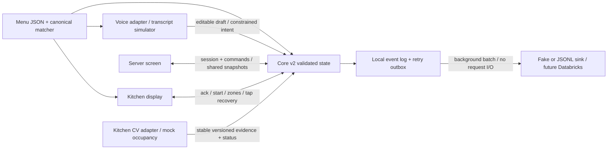

# Architecture

The retained stack is FastAPI/Python 3.11+, uv/lockfile and buildless static HTML/CSS/JS. No database/framework/platform migration is required. `/api/v2` is the current MVP authority; v1 coordination and the older voice lab remain isolated preservation surfaces.

## Ownership and source boundaries

Menu/Core owns the operational authority, event endpoint and integration; individual names remain unassigned. `app/mvp/menu.py` owns the menu schema/store/matcher; reviewed JSON is under `backend/fixtures/menus/`. `voice.py` consumes that schema and returns structured IDs/flags without retaining capture text. `contracts.py` owns v2 operational models/commands; `domain.py` owns transitions, revision/identity checks, atomic allocation, notification and event emission. `fixtures.py` provides actors, tables, cameras and six one-unit zones. `api.py` exposes sessions/state/menu/commands/events/health.

`app/analytics/events.py` owns CanonicalEvent. Its stable identity/source time/outcome are retained through `outbox.py` and local adapters. Domain transaction rollback and local enqueue are coordinated; external drain happens separately. The outbox releases its queue lock during sink I/O so a slow/failing sink does not hold restaurant operations. Databricks SQL/templates live in `analytics/`; no live connector is required.

Primary frontend files are `index.html`, `app.js`, `mvp.css`; suggested screen ownership is Voice→Server and CV→Kitchen zones, subject to explicit team agreement. Shared shell/queue and contracts require Menu/Core integration. No frontend state is an independent restaurant authority; polling reads one backend, exact retry IDs preserve uncertain requests.

## State and safety boundaries

One process/lock owns demo orders, sessions, idempotency receipts and pending export. Restart loses them; separate processes/workers diverge. No production authentication, crash recovery, multi-instance database or durable outbox is claimed. A future persistent implementation must commit state/idempotency/events/outbox atomically and preserve contracts.

Draft flags/revisions gate Confirm. On acknowledgment, K free empty zones reserve atomically for K dish units; insufficient capacity waits FIFO. Stable camera signals carry zone/version/time, occupancy, stable duration and hand status. Core does not analyze pixels or establish the truth of the producer’s reported stability. Ready-only convention is explicit, not food recognition. Unknown/blocked status preserves uncertainty; tap actions/reconciliation remain available. Timers preserve missing start/typical data.

Canonical facts distinguish `outcome:accepted` from `observed` evidence/clarification. A rejected stale event cannot silently become `dish.ready` analytics. Derived system facts receive deterministic related IDs; retries do not add state/rows. Source timestamps remain distinct from receipt timestamps. No raw transcript/audio/video enters v2 log/export. The current legacy voice lab’s SQLite call log is separate and does not receive MVP capture.

## Versioned preservation

`app/coordination/` and `/api/v1` retain the broad task/helper/old-ready scaffold against `coordination-v1.html`/`.js`. `legacy.html`, original WebSocket/session endpoints and parser/eval retain the original voice experiment. They share a server process but **not operational state or schemas** with v2. New lanes must target v2; do not dual-write or claim orders synchronize. [API](API.md) records the explicit breaking semantics and compatibility mapping; [v1 archive](archive/2026-11-14-v1-scaffold.md) preserves prior intent/evidence.
