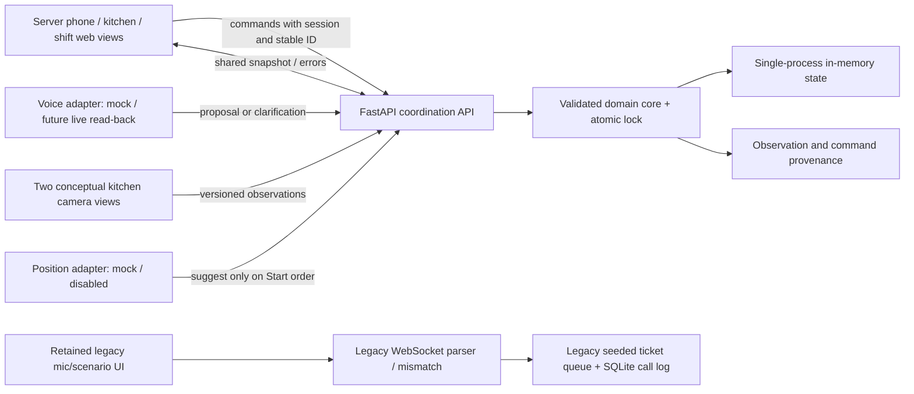

# Architecture

Existing stack retained: Python 3.11+, FastAPI, uv/lockfile, buildless static frontend. The original kitchen-copilot parser/mismatch/audio evaluation code is preserved alongside the coordination module. There is no monorepo/framework migration.

`backend/app/coordination/contracts.py` is the source of truth for validated inputs; fixtures supply deterministic menu/tables/actors/zones/bays. The domain owns invariants, transitions, idempotency, claims, and derived ticket/task state. `domain.py` orchestrates one locked transaction; `kitchen.py` holds dish/observation rules, `tasks.py` holds claim/helper rules, and `rules.py` holds common rejections. These rule functions accept explicit state and must run within the orchestrator’s lock. API handlers translate domain errors to actionable HTTP errors. Adapters describe availability and produce observations/proposals; they cannot bypass domain validation. See [API](API.md) for exact endpoints/schema links.

Clients must not maintain independent authoritative restaurant state. They send stable command IDs and expected revisions/assignment versions where required, show current server state, and surface errors. A failed request is not successful merely because a button was tapped. Retry the same ID for the same logical request; use a new ID for a new operation.

## Runtime and limits

The coordination authority is one process with a lock, not durable storage or production event sourcing. Duplicate detection and sessions reset with restart. Run one worker; separate instances diverge. For durable/multi-worker use, persist state, idempotency keys and transitions in one transaction-capable store, add real auth/authorization and operational controls, and preserve the protocol. Domain tests are not proof of crash recovery.

The demo actor selector simulates staff sessions. Diarization is not identity. Never expose the mock session system as production access control. Camera/voice/positioning status remains visibly mock, disabled, or unavailable. No raw camera recording is introduced. No real POS/payment or analytics service is on the live critical path.

The legacy WebSocket experiment has its own in-memory seeded queue per capped session and SQLite call log. It parses fire calls and checks mismatches; it does not submit structured Dig In orders or authenticate staff. Existing Deepgram transport/pipeline/eval modules remain useful work in their lane. Historical Pipecat/Daily/Next.js/TTS/Coval claims exceeded actual wiring in places; consult source and [STATUS](STATUS.md), not the archived architecture.

## Contract evolution and lane boundaries

Change schemas centrally, update deterministic fixtures and consumers together, and obtain review from dependent lanes. Compatible optional additions may retain schema v1; breaking shapes or semantics require a version/migration plan. No hidden field redefinition in frontend, hardware, or speech modules. [WORKSTREAMS](WORKSTREAMS.md) assigns role slots and [DEVELOPMENT](DEVELOPMENT.md) describes handoff and Git integration.
