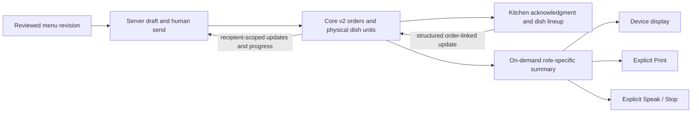

# Separate service flows, one shared restaurant

The user authorized this bounded service coordination addition on 2026-11-14.
Server and Kitchen remain distinct user journeys over the same menu-aware v2
order/dish authority. Menu setup remains a secondary lead configuration journey.
This supersedes the earlier blanket deferral of all task lineups and spoken
responses only for the specific summary/update features described here.

## Server journey

1. Enter a server device/session, select a table and create an order draft.
2. Add menu items or deliberately capture a read-back. Correct quantities,
   modifiers/requests and table flags; human Confirm sends the current revision.
3. Follow acknowledgment, zone waiting, per-dish cooking and partial/all-ready
   progress. Existing drafts/tickets stay on their original menu revision.
4. Receive kitchen updates targeted to the order's owning server. An update is
   coordination evidence, not an automatic readiness/pickup fact. Explicitly mark
   it seen/actioned through its own update controls.
5. Ask for a fresh service summary. Read the generated device display and choose
   an appropriate order/update action. Print or explicitly request spoken playback
   if desired. Summary retrieval does not itself change restaurant state.
6. Pick up actual ready plates through existing explicit/manual or validated camera
   paths; Delivered remains optional after pickups. No summary or update bypasses
   these rules.

## Kitchen journey

1. Enter a kitchen device/session; review incoming submitted tickets.
2. Acknowledge a specific order: Core reserves all K physical dish zones or queues
   it FIFO with no partial reservation. Acknowledgment does not start cooking.
3. Use the lineup of canonical dish units to start/change the current work through
   existing dish actions. This lineup is a projection, not an independent task
   lifecycle that can disagree with cooking state.
4. Send a structured, order-linked update to the server responsible for that order.
   Sender/recipient derive from authoritative sessions/orders rather than typed
   names. Missing or ambiguous targets require selection.
5. Complete plates through existing ready-only zone evidence or explicit tap
   recovery. The first plate is partial progress; one all-ready notification waits
   for every required unit. Pickup releases capacity and retries waiting orders.
6. Ask for the kitchen summary to inspect the lineup/waits/updates without mutating
   cooking state. The team can add richer scheduling through a reviewed extension
   without reviving legacy v1 task/helper/priority state.

## Connection between journeys

A staff update acknowledgment records communication handling only. It cannot
acknowledge an order, start/complete cooking, clear uncertainty, allocate zones,
or mark a plate picked up. Each write uses the existing exact-envelope retry and
Core event/outbox transaction. No external adapter owns operational state.

## Summary and audio boundaries

Summary text is deterministic, generated from one backend snapshot, with its
role, recipient context and generation time. Server summaries concern that
server's orders/updates; kitchen summaries concern the kitchen lineup. Counts
separate submitted/acknowledged/started/ready/waiting stages; missing start times
or typical minutes stay unknown. A summary is a point-in-time view, not a promise
that a ticket is still unchanged after staff acts.

Text is always available. Print opens the browser/device print path; it does not
prove paper was printed. Speak is a separate explicit action with Stop, browser
capability detection and cancellation on identity/view changes. The web app uses
the device's selected audio output; headphones/earpiece routing and quiet-room
intelligibility cannot be guaranteed by this scaffold. Browser/OS voices may have
their own implementation/retention behavior. No automatic spoken response, raw
transcript replay, microphone capture, new paid TTS integration or voice identity
is introduced by summary playback.

## Navigation and extension

Use [AGENT_TASK_MAP](AGENT_TASK_MAP.md) for exact code ownership, [API](API.md) and
`/api/v2/contracts` for executable shapes, and [INTEGRATION_GUIDE](INTEGRATION_GUIDE.md)
for teammate handoffs. Service projections and presentation live in focused
modules; canonical menu/contracts/domain remain the authority. The old v1 task
queue stays isolated. Future snippets must enter at these seams, preserve tests
and source provenance, and must not overwrite unrelated work.

## Demo routing is not confidential delivery

The summary endpoint and update-handling commands scope their behavior to the
current session/recipient. Existing `/state` and command response snapshots remain
global demo snapshots, so they are not a private-inbox or authorization boundary:
other demo clients may inspect the global operational state, including update
notes. Do not enter confidential staff/guest details. Production authenticated,
recipient-filtered state delivery is separate work; UI hiding is not access control.
